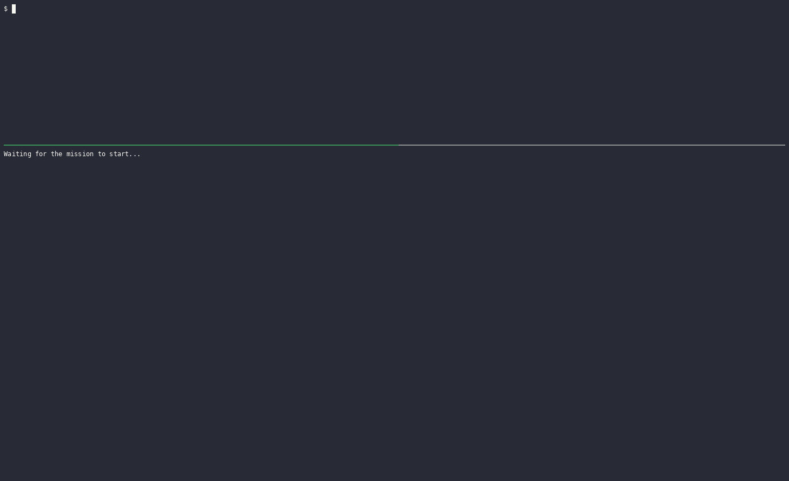

<div align="center">
  <h1>Project Autopilot</h1>
  <h3><em>Give it a request. It plans, codes, reviews and tests the work with your coding agents, until it passes.</em></h3>
</div>

<p align="center">
  <a href="LICENSE"></a>
  <a href="https://www.npmjs.com/package/project-autopilot"></a>
  
</p>

<p align="center">
  
  <br/><sub>Install and set up a project in about a minute (Enter takes the default answers). Then run <code>ap run "your request"</code>.</sub>
</p>

<p align="center">
  
  <br/><sub>A real 14-minute run, sped up. Left: <code>ap run</code>; right: the live watch report.</sub>
</p>

Project Autopilot (`ap`) runs a team of AI coding agents on your repository.
You write what you want in one sentence. Autopilot gives each step to a
different agent and checks every result before it moves on:

```text
Planning → Plan Review → Implementation → Code Review → Gate (your tests) → Verification → Final Review → you commit
```

- A **planner** writes the plan and a task list.
- A **plan reviewer** checks the plan. The planner fixes it until the reviewer approves.
- An **implementer** codes the tasks, one task per session.
- A **code reviewer** checks each phase. The implementer fixes what it finds.
- Your **test suite** (the gate) runs after each phase.
- A **verifier** checks the phase against the plan and the test results.
- A **final review** checks the whole change once at the end.

Each role can be a different CLI and model, for example Claude Code for
planning and review and a free opencode model for coding. The reviewers run
read-only, and **Autopilot never commits or pushes**: when the mission is done,
the changes wait in your working tree for you to review and commit.

**Works with:**

- **[SpecKit](https://github.com/github/spec-kit)** — if your project uses
  SpecKit (`.specify/`, `specs/*/tasks.md`), Autopilot picks up its tasks and
  implements, reviews and tests them. Without SpecKit it writes its own plan
  (`PLAN.md` + `TASKS.md`) — nothing else to install.
- **[Playwright](https://playwright.dev)** — built in: the verifier checks
  browser tasks in a real browser (install the browser once with
  `npm run playwright:install`).
- **Agent CLIs** — Claude Code, opencode, Codex and Antigravity, mixed freely
  across the roles.

## Install

Needs Node.js 18+, Git and at least one signed-in agent CLI
([details](#get-started)).

```bash
npm install -g project-autopilot
cd your-project && ap setup
ap run "your request"
```

`ap` is installed **once per machine**; each project is set up **once with
`ap setup`** (its own settings, slash commands and missions in `.autopilot/`).
If you forget, the first `ap run` in a project starts the setup by itself.
To update to a new version, run the same `npm install -g` command again; your
projects keep their settings. (Version 12 is the first public release; earlier
versions were private development.)

## Contents

- [Install](#install)
- [Choose how to use it](#choose-how-to-use-it)
- [Get started](#get-started)
- [How a mission works](#how-a-mission-works)
- [What runs where: support status](#what-runs-where-support-status)
- [Commands](#commands)
- [Slash commands in your agent](#slash-commands-in-your-agent)
- [Adhoc reviews (plan-review, code-review, verify-file)](#adhoc-reviews-plan-review-code-review-verify-file)
- [Mission control: stop, cancel, reset, rebase, finding](#mission-control-stop-cancel-reset-rebase-finding)
- [Watching a mission: the WATCH-REPORT](#watching-a-mission-the-watch-report)
- [Roles, models and fallbacks](#roles-models-and-fallbacks)
- [Limits: caps, retries and timeouts](#limits-caps-retries-and-timeouts)
- [Safety model](docs/safety.md)
- [Platforms and runtime modes](#platforms-and-runtime-modes)
- [Planning frameworks: standalone, SpecKit, GSD](#planning-frameworks-standalone-speckit-gsd)
- [Configuration](#configuration)
- [Files Autopilot creates](#files-autopilot-creates)
- [Troubleshooting and FAQ](docs/troubleshooting.md)
- [Known limitations](#known-limitations)
- [Development and tests](#development-and-tests)
- [Configuration reference](docs/configuration.md)

## Choose how to use it

| What you need | Run | Outcome |
| --- | --- | --- |
| Build a feature or fix a bug from start to finish | `ap run "<request>"` | A reviewed plan, coded and tested phase by phase, waiting in your working tree |
| Only a reviewed plan, to read before any code is written | `ap run --stage planning "<request>"` | `PLAN.md` + `TASKS.md` approved by the plan reviewer |
| Run one step of an open mission yourself | `ap run --stage implement \| review \| verify` | That one step for the current phase, then it stops |
| A second opinion on a plan you already have | `ap plan-review <plan-file>` | A verdict and findings; nothing is changed |
| A review of a commit, a range, a diff or a folder | `ap code-review <target>` | A verdict and findings; nothing is changed |
| Check code against a list of requirements | `ap verify-file <criteria-file> [--cmd "<tests>"]` | A verdict per requirement, with the test output as evidence |

The same commands are available as `/ap.*` slash commands inside Claude Code,
opencode and Antigravity (see [Slash commands](#slash-commands-in-your-agent)).

## Get started

**You need:** Node.js 18 or newer, Git, and at least one supported coding-agent
CLI that is installed and signed in (Claude Code, opencode, Codex or Antigravity).
On Linux and WSL2 you also need `bubblewrap` for the read-only reviewers
(`sudo apt install bubblewrap` on Debian/Ubuntu).

**1. Install** — one command, then `ap` works in every terminal:

```bash
npm install -g project-autopilot
```

**2. Set up a project** — from the project folder (a Git repository):

```bash
cd my-project
ap setup
```

The setup wizard finds the installed CLIs and planning frameworks, asks which
CLI and model each role uses, suggests a test command for the gate, saves
`.autopilot/config.json`, adds `.autopilot/` to `.gitignore`, and installs the
`/ap.*` slash commands for the agents it found. If you skip this step,
`ap run` starts the wizard by itself the first time.

**3. Run a mission:**

```bash
ap run "Add a dark-mode toggle to the settings page"
```

**4. Watch it** — open `.autopilot/missions/<NNN-name>/WATCH-REPORT.md`. It
refreshes as the mission runs (see [WATCH-REPORT](#watching-a-mission-the-watch-report)).

**5. Review and commit** — the mission ends with
`ALL WORK COMPLETE — HUMAN COMMIT REQUIRED`. Read the diff (`git diff`) and
commit it yourself.

A mission can take a long time (tens of minutes to hours). To keep it running
after you close the terminal, use `ap run --detach "<request>"` on Linux/WSL2;
it runs under `systemd-run` when available (otherwise `setsid`) and writes
its output to the mission's `orchestrator.log`.

### Other ways to install

- **Update:** run the same `npm install -g …` command again.
- **Remove the CLI:** `npm uninstall -g project-autopilot`. To remove Autopilot from
  one project instead, run `ap uninstall` there (see [Commands](#commands)).
- **Latest code from GitHub:** `npm install -g github:mmetwally-dev/project-autopilot`.
- **From a local folder:** `npm install -g <path-to-project-autopilot>`.
- **Developing the skill itself:** run `npm link` once inside the checkout; `ap`
  then runs that folder, so every edit is live. `npm unlink -g project-autopilot` undoes it.
- **No global install:** `node <path>/bin/ap.cjs <command>` always works.
  Two thin launchers ship beside it: `bin/ap.cmd` for Native Windows (uses the
  Windows `node`) and `bin/ap` for Linux/WSL2 (uses the distro's `node`). They
  only forward the arguments and the exit code. On WSL2, `bin/ap` refuses a
  Windows `node.exe` reached through interop instead of running the wrong runtime.
- **WSL2:** a Windows `ap` hands WSL2 missions over to WSL by itself. To type
  `ap` inside a WSL shell too, run the same `npm install -g` there with the Linux `npm`.
- **Coding-agent skill discovery (optional):** to let an agent find the skill
  through its `SKILL.md`, place the folder in your agent's skills directory
  (for example `npx skills add mmetwally-dev/project-autopilot`). Typing `ap`
  yourself does not need this.
- **Browser checks:** the verifier can use Playwright when a task needs a
  browser. Install the browser once with `npm run playwright:install` from the
  package folder.

If Node.js is missing, the launchers say that Node.js 18 or newer is required
and exit with code `127`; nothing is downloaded or changed.

There is no signing, certification or admin install. Each `ap run` does a quick
**preflight** instead: it checks that each configured CLI exists and answers
`--version`/`--help`, that the configured model/effort/variant flags exist for
that CLI, and that the repository and scratch paths are usable. A failed
preflight is a plain error message. (`ap adapter certify` and `ap adapter status`
still exist for old scripts; they only print that certification is no longer needed.)

## How a mission works

A **mission** is one request carried from plan to finished code. Each mission
has its own folder, `.autopilot/missions/<NNN>-<slug>/`, which keeps the plan,
the task list, the logs and the report after the mission ends.

### 1. Planning and plan review

The planner reads the repository and writes `PLAN.md` (goal, scope, design)
and `TASKS.md` (phases of small tasks). Every task is one concrete action on
about one file, names the exact paths, and says how it is accepted and how to
verify it, for example:

```text
- [ ] **1.2** Add `fillConfigFile()` to `scripts/config-fill.mjs` with a timestamped backup
      — accept: the file gains the defaults and the backup matches the original
      ; verify: node scripts/test-config-fill-file.mjs
```

The read-only plan reviewer then reads the plan against the request and the
code. If it finds problems (verdict **DENIED**), the planner revises and the
reviewer looks again, up to `retries.plan_revisions` rounds (default 8). An
**APPROVED** plan moves on to coding. With `ap run --stage planning` the mission
stops here so you can read the plan first.

### 2. Implementation, phase by phase

For each phase:

1. **Implementer** — each task runs in its own fresh session. If a task hits
   its turn or token cap, the implementer writes a hand-off note
   (`handoff/<task>.md`: what is done, what is next) and a new session continues
   from it, up to `caps.implementer.extra_sessions` more sessions (default 5).
2. **Code review** — the read-only code reviewer checks the phase's changes. On
   DENIED, only the tasks named by the findings are re-run with the findings
   attached, and the reviewer then checks just its earlier findings plus the fix.
3. **Gate** — Autopilot itself runs your test commands (`tests.gate_commands`,
   for example `npm test`). If tests fail, it re-runs them against the code as it
   was before the phase: tests that also failed before are not blamed on this
   phase; new failures go back to the implementer as a fix round.
4. **Verifier** — the read-only verifier checks every task of the phase against
   its acceptance line, using the gate's results as evidence, and only then
   ticks the tasks done in `TASKS.md`. Browser tasks can be checked with Playwright.

A failed review or verification sends the work back to the implementer. Each
kind of failure has its own budget (`retries.implementation`,
`retries.verification`, default 4). When a budget runs out the mission
**escalates** (see below) instead of looping forever.

### 3. Final review

When every phase has passed, the code reviewer reads the whole mission's
change once more. Findings get up to `retries.final_review_fix_rounds` fix
rounds (default 2). When it approves, the mission is **COMPLETED** and prints
`ALL WORK COMPLETE — HUMAN COMMIT REQUIRED`.

### When a mission stops: escalation

If Autopilot cannot finish safely — a budget is spent, a task stops making
progress, a CLI keeps failing, or something unexpected touched the repository —
it **escalates**: it saves its state, prints the reason and
`STOP — human intervention required`, and the report shows `ESCALATED`. Nothing
is reverted. Read the reason (the last lines of the run, or the WATCH-REPORT),
fix the cause, then:

- `ap run` (no request) resumes the same mission where it stopped;
- `ap reset` first, if the stop was a spent budget, gives it fresh attempts;
- `ap cancel` ends the mission if you want to give up on it.

The messages name the exact command when one is needed, for example
`Resume: ap reset --scope <key> then ap run`.

### Resuming and starting over

- `ap run` with **no request** resumes the open mission from its last checkpoint
  and re-runs only unfinished work. The same happens with the **same** request.
- `ap run "<a different request>"` while a mission is open **abandons** that
  mission and starts a new one. It does not ask (a question would break
  unattended runs); it prints a clear takeover block instead: which mission is
  abandoned, at which step, what survives (the mission folder, your files, your
  Git tree — nothing is reverted) and which spent failure counters are cleared
  for the new mission. Use `ap cancel` to end a mission without starting another.

### Smarter retries

- **Escalation model.** The planner and implementer can have a stronger
  `escalation_model`. If a reviewer reports the same finding as *not fixed*
  `retries.escalate_after_not_fixed` times in a row (default 2), the next fix
  round runs on the escalation model, once per scope, then the role returns to
  its normal model.
- **No-progress stop.** A continuation session that changes no project file is
  "no progress". After `retries.no_progress_sessions` of them in a row
  (default 2) the task stops early instead of using up all its sessions. The next
  session's brief quotes the code lines the hand-off note points at, so it can
  edit right away.
- **Hung sessions.** A session that prints nothing, runs nothing and writes
  nothing for `time_limits.silent_run_minutes` (default 10) is stopped as
  `IDLE_HANG`; a provider rate-limit storm is caught as `RATE_LIMITED`. Both count
  as retryable infrastructure failures, not as the agent's fault.

## What runs where: support status

**Fully supported and tested in this version** — standalone and SpecKit
projects; the Claude Code, opencode, Codex and Antigravity CLIs as roles; Linux,
WSL2 and Native Windows.

**Not yet reviewed in this version — coming in a future version:**

- **GSD** projects. The GSD adapter is in the code (phase PLANs, waves,
  planning-review stages), but it has not been reviewed and tested end to end
  for this release. Its documentation and support will be completed in a future
  version; use standalone or SpecKit for now.
- **Cursor** (`cursor-agent`). It is accepted as a role CLI and appears in the
  setup list, but it has not been reviewed or tested yet. Full support and
  documentation are planned for a future version.

| | Role CLI (runs planner/implementer/reviewers) | `/ap.*` slash commands | Model list in `ap config` |
| --- | --- | --- | --- |
| Claude Code (`claude`) | Yes | Yes — `.claude/commands/ap.<cmd>.md` | Documented aliases (no live list command) |
| opencode (`opencode`) | Yes, incl. free `*-free` models | Yes — `.opencode/command/ap.<cmd>.md` | Live (`opencode models`) |
| Codex (`codex`) | Yes | No (see below) | Live (app-server `model/list`) |
| Antigravity (`agy`) | Yes | Yes, in the `agy` CLI — `.agents/skills/ap.<cmd>/SKILL.md` | Manual entry |
| Cursor (`cursor-agent`) | Not yet reviewed — future version | No (see below) | Not yet reviewed |

| Framework | Status |
| --- | --- |
| Standalone (no framework) | Supported — the default; plans live in the mission folder |
| SpecKit | Supported |
| GSD | Not yet reviewed — future version (needs Strong mode) |

| Platform | Mode | Read-only reviewers |
| --- | --- | --- |
| Linux | `linux-strong` | OS-enforced with bubblewrap |
| WSL2 (Windows) | `wsl2-strong` (recommended on Windows) | OS-enforced with bubblewrap |
| Native Windows | `windows-compatibility` | Disposable-copy isolation (not OS-enforced) |
| macOS | not tested — [help wanted (#1)](https://github.com/mmetwally-dev/project-autopilot/issues/1) | — |

## Commands

Every command takes `--repo <path>`; the default is the current folder.

| Command | What it does |
| --- | --- |
| `ap setup` | First-time setup wizard for this project (roles, models, gate, runtime mode); also installs the slash commands |
| `ap run ["<request>"]` | Run a mission from start to finish; with no request, resume the open one |
| `ap run --stage <planning\|implement\|review\|verify>` | Run one stage only, then stop |
| `ap run --detach ["<request>"]` | Run in the background (Linux/WSL2) |
| `ap stop [--yes] [--dry-run]` | Stop the running mission but keep it; `ap run` continues it |
| `ap cancel ["<reason>"] [--yes] [--dry-run]` | End the mission for good (stops a live run first) |
| `ap reset [--scope <key>]` | Give spent retry counters a fresh start |
| `ap rebase [--note "<why>"] [--yes]` | Accept your own edits made while a mission was paused |
| `ap finding list` / `ap finding drop <n> [--note "<why>"] [--yes]` | List the current review findings / drop one you disagree with |
| `ap config [--role <role>]` | Change roles, models, the test command and other options interactively |
| `ap config show [--path <key.path>] [--explain]` | Print the effective settings, each marked `[default]` or `[from config.json]`; `--explain` adds a one-line explanation under each setting |
| `ap config fill [--dry-run]` | Add every missing setting at its default (after an upgrade) |
| `ap commands` | Re-install the `/ap.*` slash-command files |
| `ap plan-review <plan-file>` | Review a plan file, outside any mission |
| `ap code-review <target>` | Review a commit, range, diff file or folder, outside any mission |
| `ap verify-file <criteria-file> [--cmd "<tests>"]` | Check the code against a list of requirements, outside any mission |
| `ap uninstall [--dry-run] [--yes] [--keep-missions]` | Remove Autopilot from this project only |
| `ap help` | Print the command list |

**Exit codes:** `0` success, a dry-run preview, or nothing to do; `1` a refusal or
failure (prompt answered `N`, `--yes` missing without a terminal, kill failed,
several live runs, reset with nothing to clear); `2` usage errors such as
`Unknown command`; `127` a launcher found no Node.js 18+.

**Confirmations.** `stop`, `cancel`, `rebase`, `finding drop` and `uninstall`
print exactly what they will do and ask `y/N`. `--dry-run` shows the plan and
changes nothing; `--yes` skips the question and is required when there is no
terminal (a script never changes state silently). `run` and `reset` never ask.

**Windows + WSL2.** With a saved `wsl2-strong` mode, `run`, `stop` and `cancel`
typed on Windows hand over to WSL, so they act where the mission really runs.

**From a batch file,** call any `.cmd` shim as `call ap ...`, otherwise CMD does
not return to your script.

`ap status` and `ap watch` are not commands; the WATCH-REPORT is the status view.

## Slash commands in your agent

`ap setup` (or `ap commands`) installs one set of `/ap.*` commands, with the
same SpecKit-style dot names in every supported agent, for the agents it finds
on your PATH. Open a new session in that agent afterwards. Type them in the
agent's **chat**; each one runs the matching terminal command, and anything you
type after the command is passed on as its arguments.

| Slash command | Does | Same as |
| --- | --- | --- |
| `/ap.run` | The whole job: plan, code, review, test until done. All phases, with fix rounds | `ap run` |
| `/ap.plan` | Step 1 only: write a reviewed plan + task list, then stop (includes the plan review) | `ap run --stage planning` |
| `/ap.implement` | Step 2 only: code the current phase, then stop (no review) | `ap run --stage implement` |
| `/ap.review` | Step 3 only: review the code just written, then stop | `ap run --stage review` |
| `/ap.verify` | Step 4 only: test the code just reviewed and tick its tasks done | `ap run --stage verify` |
| `/ap.plan-review` | Review a plan file you give (outside any mission) | `ap plan-review <plan-file>` |
| `/ap.code-review` | Review a commit, range, diff or folder (outside any mission) | `ap code-review <target>` |
| `/ap.verify-file` | Check the code against your requirements list (outside any mission) | `ap verify-file <criteria-file> [--cmd "..."]` |
| `/ap.stop` | Pause the running mission (continue later with `/ap.run`) — user-only | `ap stop --yes` |
| `/ap.cancel` | End the current mission for good — user-only | `ap cancel --yes` |

- `/ap.plan` and `/ap.run` can start a new mission from a request or resume the
  open one. `/ap.implement`, `/ap.review` and `/ap.verify` need an already-planned
  mission, act on its current phase only, and work with standalone missions only.
- **User-only:** `/ap.stop` and `/ap.cancel` can only be typed by you, never
  started by the model (Claude Code: `disable-model-invocation: true`; opencode
  commands are user-typed by design). Typing them is the confirmation, so they
  pass `--yes`. `ap stop` stops only the mission's own process, never your chat session.
- `reset`, `rebase`, `uninstall`, `setup` and `config` are terminal-only.

Where the files go: Claude Code `.claude/commands/ap.<cmd>.md`, opencode
`.opencode/command/ap.<cmd>.md`, Antigravity `.agents/skills/ap.<cmd>/SKILL.md`.
Generated files carry a marker; your own files are never touched, and older
generated names (`.claude/commands/ap/*.md`, `.opencode/command/ap-*.md`) are
cleaned up by `ap setup`, `ap commands` and `ap uninstall`.

**Agents without slash commands:**

- **Codex** — no verifiable custom-prompt loader in codex 0.150.1 (no
  `~/.codex/prompts` support found in the binary). Codex still works as a role
  CLI; use the terminal commands.
- **Cursor** — the `.cursor/commands` format is not verifiable offline (no Cursor
  CLI installed when this was built). Planned for a future version together with
  Cursor role support.

**Antigravity notes.** `/ap.*` commands are verified in the `agy` CLI (1.3.4+).
The Antigravity IDE (2.5.x) shows no slash commands at all when the workspace
is in WSL, so IDE-over-WSL is not supported yet. `/ap.stop` and `/ap.cancel` are
not generated for Antigravity, because its skills can be started by the model
with no way to turn that off; use `ap stop --yes` / `ap cancel --yes` in a terminal.
Headless `agy` runs use `--mode accept-edits` for writing roles and
`--mode plan` for read-only roles, never `--dangerously-skip-permissions`; a
write run that needs a command permission fails clearly with `PERMISSION_DENIED`.

## Adhoc reviews (plan-review, code-review, verify-file)

One-shot reviews that run **outside any mission**: they change no mission
state and never commit. They use the same role configuration as missions.

```bash
ap plan-review docs/PLAN.md                     # role plan_reviewer
ap code-review HEAD~3..HEAD                     # a range
ap code-review --commit 1a2b3c4                 # one commit
ap code-review --diff-file my-change.diff       # a diff file
ap code-review src/payments                     # a folder
ap verify-file requirements.md --cmd "npm test" # role verifier, with test evidence
```

- `ap code-review` takes `<range> | <commit> | <diff-file> | <path>`, or the
  explicit `--range <a..b>`, `--commit <sha>`, `--diff-file <file>`.
- `ap verify-file` reads a criteria file (one requirement per line or bullet).
  With `--cmd`, Autopilot runs that command first, outside the reviewer's
  sandbox and never in a way that can write to your repository, and gives its
  output to the verifier as evidence.

**Refusals** (exit 2, nothing runs): missing or unreadable input, `verify-file`
with no checkable criteria, `code-review` with an invalid range/commit or a diff
it cannot resolve, and `--cmd` on anything but `verify-file`. Agent/runtime
failures exit 1.

**Output** goes to `.autopilot/adhoc/<timestamp>-<role>/summary.md` (verdict,
findings and the `--cmd` evidence), plus `cmd-evidence.txt` when `--cmd` was used.
The agent run's own files are in a `NN-<role>-<id8>/` subfolder named in the summary.

## Mission control: stop, cancel, reset, rebase, finding

Five operator-only commands act on the **active** mission. Every one records
what it did in `state.json` and in the WATCH-REPORT, so the history stays readable.

| You want to… | Use |
| --- | --- |
| pause now and continue later | `ap stop` |
| give up on this mission | `ap cancel` |
| retry after a budget ran out | `ap reset`, then `ap run` |
| keep your own edits made during a pause | `ap rebase --note "<why>"`, then `ap run` |
| reject a review finding you disagree with | `ap finding list`, `ap finding drop <n>` |

```bash
ap stop --dry-run                          # show the live process; kill nothing
ap stop --yes                              # stop now, keep the mission
ap cancel "superseded by a new request"    # shows the plan, asks y/N
ap cancel --dry-run
ap reset                                   # clear every spent counter
ap reset --scope infrastructureRetryBudget:mission
ap reset --scope standalone:P2:T1:7d1f10325a73   # one task's session allowance (bare task id)
ap rebase --note "fixed the import path by hand" --yes
ap finding list
ap finding drop 4 --note "operator code, not phase work" --yes
```

### `ap stop` — pause, keep the mission

Stops the live run and keeps everything: state, checkpoints, counters. It sends
SIGTERM, waits 10 seconds so the run can save its state, and only then SIGKILL
(`taskkill /T`, then `/T /F` on Windows). The runs it stopped are marked
`INTERRUPTED`. `ap run` with no request resumes. With nothing running it says
`No mission is running.` (or names the idle mission and points at `ap cancel`)
and changes nothing.

### `ap cancel [reason]` — end the mission

Prints the plan first — the mission, its phase/step, the fields it will clear,
what it keeps — then asks `y/N`. If a run is alive, the same single prompt covers
stopping it, and the process is confirmed dead before any state is cleared (a
failed kill leaves the mission untouched). Answering `N` prints
`aborted — nothing was changed.` and exits 1.

After `y`: the mission's phase/step become `cancelled`, its mission-scoped state
is cleared (checkpoints, current phase/task, feedback, last failure and the like),
and the reason is saved in `lastCancelled`. It does **not** revert any file or
Git change and does **not** delete the mission folder, which stays as the record.
Failure counters are left alone and cleared when the next mission starts.
The next `ap run "<request>"` starts a new mission.

### `ap reset [--scope <key>]` — fresh attempts

When a retry budget runs out, the mission escalates. `ap reset` gives it one
more chance without starting over:

- **No `--scope`:** clears every spent counter — all failure budgets, all task
  session allowances and their dead-ends, and the plan revision counter. Review
  feedback, the stage position and hand-off notes are kept.
- **`--scope <key>`:** clears one thing only:
  - a failure budget, e.g. `infrastructureRetryBudget:mission`;
  - a task's session allowance — the full key, the scope
    (`task:standalone:phase-1:<taskId>`) or just the task id. It keeps the task's
    hand-off note, which is the useful context for the next session. After a
    "did not converge" stop, a bare `ap reset` targets that task automatically;
  - `standalone-plan-revision`, the plan review round counter;
  - `fallback:<role>`, to drop a role's sticky fallback model and go back to its primary.

While a mission is **stopped**, the reset applies at once. While a mission is
**running**, it is queued (`.autopilot/reset-request.json`) and the running
mission applies it at its next failure decision, so it continues instead of
escalating — no stop or restart. A reset buys more attempts; it does not fix the
cause, so a revoked login, a denied path or a real test failure will come back.
With nothing to clear it exits 1 and lists the kinds of target it accepts.

### `ap rebase [--note "<why>"] [--yes]` — accept your own edits

Autopilot fingerprints the files of the current phase. If you edit or commit
something while the mission is paused, the next `ap run` stops with a
checkpoint drift (`PHASE_CHECKPOINT_DRIFT`) instead of mixing your change into
the agents' work unnoticed. `ap rebase` accepts your change: it re-points the
checkpoint at the current files, moves the phase's baseline onto `HEAD` (so your
commits stop showing up as phase work), and records your edit. The `--note` text
is shown to the next implementer and reviewer as
`Operator note: … (from ap rebase)`. The stage position does not change. It
refuses while a run is live; with no drift it still re-bases the baseline, or
prints `nothing to rebase`.

### `ap finding list` / `ap finding drop <n>` — reject a finding

`ap finding list` numbers the open review findings of the current phase.
`ap finding drop <n>` removes finding *n* from the saved feedback and the
review history, so the next fix round no longer asks the implementer to change
it. The dropped finding, your note and the time are recorded. `--scope <key>`
targets another feedback scope. Refuses while a run is live.

## Watching a mission: the WATCH-REPORT

`.autopilot/missions/<mission>/WATCH-REPORT.md` is the live status page. It
opens with the pipeline state:

```text
=== PIPELINE STATE ===
Mission: 097-implement-backlog-item
Status:  COMPLETED
Stage:   done
Budgets: implementation=0/4 (2 in earlier phases)  verification=0/4  adapter=0/3  infrastructure=0/3
Total:   9.27M · elapsed 04:57:30 wall (planning 1.32M · phase 1 2.17M · …)
```

**Status** is one of `RUNNING`, `STOPPED`, `ESCALATED`, `COMPLETED`, `CANCELLED`.
Then one section per stage (planning, each phase with its attempts, final
review), and one row per agent run:

```text
ROLE                       MODEL                     TASK         STATUS     DURATION  PRICE   CONTEXT  TURNS  NOTE
07-implementer-eac2b56a    deepseek-v4.1-flash-free  T1.1         COMPLETED  00:01:04  92.1K   31.2K    15     session 1 of 6
14-code_reviewer-f0061b9e  opus-5.5                  T1.1 > T1.7  DENIED     00:01:53  182.2K  66.4K    15     phase review · 3 findings
GATE (orchestrator)        -                         T1.1 > T1.7  PASS       00:27:07  -       -        -      full test suite
```

- **STATUS** — `COMPLETED` (a writing role finished), `APPROVED`/`DENIED` (a
  reviewer's verdict), `PASS`/`FAIL` (the gate), `INTERRUPTED` (stopped by `ap stop`).
- **PRICE** — tokens used; it starts with `~` while the run is still going.
  **CONTEXT** — the largest context the session reached. **TURNS** — model turns.
  `-` means the CLI reports no usage.
- **NOTE** — the session number, the number of findings, and warnings such as
  `⚠ high usage` (over the role's cap).

The same folder has `orchestrator.log` (the full log), `gates/` (each gate's
output), `handoff/` (hand-off notes), `phase-briefs/` and `runs/` (each agent
run's brief, output and result).

## Roles, models and fallbacks

| Role | Writes to the repo? | Job |
| --- | --- | --- |
| `planner` | Yes (the plan files) | Writes `PLAN.md` and `TASKS.md`, revises them after review |
| `plan_reviewer` | No — read-only | Approves or denies the plan with findings |
| `implementer` | Yes | Codes one task per session; fixes findings |
| `code_reviewer` | No — read-only | Reviews each phase, and the whole change in the final review |
| `verifier` | No — read-only | Checks each task's acceptance line with the gate results; ticks tasks done |

Each role has a `cli`, `model`, `reasoning` (effort), `variant`, and optional
`fallbacks`; the planner and implementer can also have an `escalation_model`.
Set them with `ap setup`, or later with `ap config` (all roles, or one with
`ap config --role implementer`).

**Keep the reviewers independent.** Never use the same model for
`code_reviewer` as for `implementer`, or for `plan_reviewer` as for `planner` —
not as primary and not as fallback. A model reviewing its own work misses its
own mistakes. `ap setup` and `ap config` warn about it.

**Fallbacks.** Each role can list fallback models, tried in order **only** when
the current model is rate-limited or out of quota — never for other failures.
The chosen fallback stays in use (sticky); the primary model is tried again
after `advanced.fallback_retry_primary_minutes` (default 60). A model that one
role found rate-limited is skipped by the other roles for the same window.
`ap reset --scope fallback:<role>` returns a role to its primary at once.

**Free models (opencode `*-free`).** When a free model has used up its
configured fallbacks on a rate limit, Autopilot tries the other free models it
discovers — never paid ones (turn this off with
`roles.free_models.auto_fallback: false`). Roles on a free model get at least
`roles.free_models.max_turns` turns (default 45), because free models often need
more turns; token caps and paid models are unchanged.

**How `ap config` finds models.** It asks the installed CLI first: opencode
`opencode models`, Codex its app-server `model/list`. These are your real,
live lists. When a CLI has no machine-readable list, Autopilot does not invent
one: it offers a dated, sourced list of documented options where one ships (for
Claude Code, its published aliases such as `opus`, `sonnet`, `haiku`, `fable`,
`opusplan`; see [anthropics/claude-code#12612](https://github.com/anthropics/claude-code/issues/12612)),
marked as **non-live**, and always lets you type a model name or leave it blank
for the CLI default. Effort levels come from the same sources (Codex has a
documented fallback list). Before saving, each role is checked: a live model must
be in the live list and unsupported flags are refused. `node scripts/doctor.mjs`
flags a documented list older than 180 days.

**What really ran.** For every run Autopilot records the exact CLI command and
checks before launch that the configured model, effort and variant are really in
it. Each run writes a result file (`autopilot-relay.result.v3`) with the
requested model, the final arguments, the exit, the session id, the touched files
and the policy status. Autopilot does not claim the provider used the model
unless the provider reports it. No separate API key is needed; Autopilot uses
each CLI's own sign-in.

## Limits: caps, retries and timeouts

Every limit is a setting; see the [Configuration reference](docs/configuration.md)
for all of them with their defaults.

- **Caps (per session):** `caps.<role>.max_turns`, `max_tokens` and
  `wrap_up_at_tokens`. Near the token cap the role is told to wrap up and write
  its hand-off; at the cap the session ends and `extra_sessions` decides whether
  a fresh session continues. `caps.mission_token_backstop` (default 6M tokens)
  stops a runaway mission. `caps.task_size_target_turns` (default 30) tells the
  planner how big one task may be.
- **Retries:** plan revisions (8), implementation failures (4), verification
  failures (4), final-review fix rounds (2), CLI errors (3), infrastructure
  failures (3), no-progress sessions (2).
- **Timeouts:** `time_limits.role_timeout_minutes` (60 per session, 180 for the
  verifier, which waits for the full test suite), `time_limits.call_backstop_minutes`
  (200, a hard stop for one call; the old name `mission_timeout_minutes` is still
  read and renamed by `ap config fill`), `silent_run_minutes` (10),
  `no_first_output_minutes` (3), `read_only_max_silence_minutes` (15) and
  `retry_wait_seconds` (60).

## Safety model

Autopilot never commits or pushes, and the read-only reviewers cannot change
your repository: on Linux and WSL2 bubblewrap mounts it read-only, while Native
Windows uses a throwaway copy. Every role is snapshotted, touched files are
recorded, and a read-only violation stops the mission.

See [docs/safety.md](docs/safety.md) for the full safety model.

## Platforms and runtime modes

`runtime.mode` decides how the read-only roles are contained. `ap setup`
detects what the machine can do: on Native Windows it asks only when both WSL2
and Windows Compatibility are usable (WSL2 Strong needs node, bubblewrap and your
agent CLIs signed in inside WSL); with one usable mode it picks that mode and
says so.

| Mode | Where | Reviewers |
| --- | --- | --- |
| `linux-strong` | Native Linux | bubblewrap, OS-enforced |
| `wsl2-strong` | Windows with WSL2 (recommended) | bubblewrap inside the WSL distro (`runtime.wsl_distro`) |
| `windows-compatibility` | Native Windows, SpecKit and standalone only | disposable-copy isolation, not OS-enforced |

With `wsl2-strong`, you can type `ap` in Windows (PowerShell or CMD); `run`,
`stop` and `cancel` are handed to WSL automatically, and the mission runs there.
The planner and implementer write to the repository in every mode.

## Planning frameworks: standalone, SpecKit, GSD

`project.planning_framework` is `standalone`, `speckit`, `gsd` or `auto`
(detect). `ap setup` detects what the project uses.

**Standalone** (the default — nothing else to install). Each mission keeps its
plan in `.autopilot/missions/<NNN>-<slug>/PLAN.md` and `TASKS.md`. All
features, including `--stage`, work here.

**SpecKit.** `.specify/workflows/speckit/workflow.yml` is the source of truth.
Its command steps (`specify`, `plan`, `tasks`) go to the planner, its gate
steps (`review-spec`, `review-plan`) to the plan reviewer, and implementation
is run by Autopilot's own engine, with the same code review, gate and
verification as standalone. Task files are found with
`frameworks.speckit.task_files` (default `specs/*/tasks.md` and friends).

**Entering a project that is already planned.** `ap run` first looks at the
existing SpecKit, GSD or Autopilot state and decides where to start:

- **missing** — no plan yet: start planning from the beginning;
- **partial** — some planning done: check it, then continue from the first
  unfinished planning step;
- **complete** — spec/plan/tasks are there: run an independent read-only check of
  the plan, then go straight to coding;
- **ambiguous** — conflicting evidence: stop and ask rather than guess.

Existing planning files are kept. Autopilot's own checkpoints take precedence
for work it started itself.

**GSD — not yet reviewed in this version, coming in a future version.** The
code contains a GSD adapter: it reads `.planning/` (PLAN frontmatter for
phase/plan/wave/dependencies), runs PLAN tasks through the same engine, can review
each planning stage (`frameworks.gsd.planning_review`), and can run independent
PLANs of one wave in separate worktrees. It requires Strong mode. It has not been
reviewed and tested end to end for this release, so it is not documented as
supported yet, and `ap setup` / `ap config` do not offer it; full documentation
will follow in a future version.

## Configuration

Settings live in `.autopilot/config.json`, in the v4 layout
(`schema_version: "4.0"`) with these sections: `project`, `roles`, `caps`,
`retries`, `time_limits`, `workflow`, `tests`, `safety`, `runtime`,
`frameworks`, `advanced`. Every setting, its default and its allowed values are
listed in the [Configuration reference](docs/configuration.md) at the end
of this page, generated from `config.schema.json`.

- **`ap config`** edits the file interactively: it shows the current roles,
  then lets you change all of them or one (`ap config --role <role>`). It edits
  the existing file and never reinstalls anything.
- **`ap config show [--path <key.path>] [--explain]`** prints the effective configuration:
  your values plus the code defaults, each marked `[default]` or `[from config.json]`.
  `--explain` adds a one-line explanation under each setting.
- **`ap config fill [--dry-run]`** adds every missing setting at its default
  (useful after an upgrade or a hand edit). It keeps every existing value
  (including `null` and empty lists), renames old setting names in place (for
  example `mission_timeout_minutes` → `call_backstop_minutes`, value kept), and
  repairs the `$schema` path so editors find `config.schema.json`. `--dry-run`
  only prints what would change. A timestamped `config.json.bak-<time>` backup is
  written before any change. It never invents a `runtime` mode you did not choose.
- **Editor help.** The `$schema` line points at the installed
  `config.schema.json`, so editors such as VS Code show descriptions,
  defaults and allowed values while you edit, and flag typos. Keys starting with
  `_` are allowed for your own comments.
- **Upgrades.** Older 2.x/3.x configs are migrated automatically on first use,
  with one timestamped backup. Removed fields (for example the old certification
  settings) are dropped; this never blocks the migration.
- **Full example:** [`config.example.json`](config.example.json) shows every setting.

Most-changed settings:

| Setting | Why you would change it |
| --- | --- |
| `roles.<role>.cli` / `.model` / `.reasoning` | Which agent and model does each job |
| `tests.gate_commands` | The test commands the gate runs, e.g. `["npm test"]` |
| `workflow.plan_review`, `workflow.code_review_per_phase`, `workflow.final_review` | Turn a review stage off (all on by default) |
| `retries.*` | More or fewer attempts before a mission escalates |
| `time_limits.role_timeout_minutes` | Longer sessions for a slow test suite |
| `tests.require_browser`, `tests.browser` | When and how the verifier uses a browser |

## Files Autopilot creates

Everything lives in `.autopilot/` (git-ignored by setup):

```text
.autopilot/
  config.json                 your settings
  state.json                  mission state and checkpoints (do not edit by hand)
  missions/<NNN>-<slug>/      one folder per mission, kept after it ends
    PLAN.md, TASKS.md         the plan and the task list (ticked as tasks pass)
    WATCH-REPORT.md           live status
    orchestrator.log          full log
    gates/  handoff/  phase-briefs/  runs/
  adhoc/<time>-<role>/        adhoc review results
  runs/                       shared run records
```

Outside `.autopilot/` it only writes the slash-command files and one
`.autopilot/` line in `.gitignore`. **`ap uninstall`** removes exactly those:
the `.autopilot/` folder and that one `.gitignore` line (matched exactly; a
similar line of yours is kept). Your code and Git tree are untouched.
`--keep-missions` first copies `missions/` to `autopilot-missions-archive-<date>`
at the repository root. It refuses while a run is live, and on a project that is
not set up it prints `Autopilot is not set up here.` and exits 0.

## Troubleshooting and FAQ

Short answers for the common stops: STOP human intervention required,
READ_ONLY_CONTAINMENT_UNAVAILABLE, PHASE_CHECKPOINT_DRIFT, rate limits, idle
hangs and gate failures. Autopilot never commits and needs no API key.

See [docs/troubleshooting.md](docs/troubleshooting.md) for the full troubleshooting guide and FAQ.

## Known limitations

- **OS-enforced read-only containment is Linux/WSL2 only.** Native Windows uses
  disposable-copy isolation, which is not OS-enforced; GSD needs Strong mode.
- **Containment covers the filesystem, not the network.** Agents keep their
  normal network access. For network-restricted unattended runs, run the whole
  process in a container or VM.
- **The preflight is a quick check, not a security boundary.** It confirms that
  each CLI runs and that the flags exist; it proves nothing about containment.
- **GSD and Cursor** are not yet reviewed — planned for a future version.
- **Antigravity IDE over WSL** shows no slash commands; use the `agy` CLI.
- **macOS** has not been tested yet. If you use a Mac, a short test run helps a
  lot: see [Help wanted: macOS testing (#1)](https://github.com/mmetwally-dev/project-autopilot/issues/1).

## Development and tests

```bash
npm test                        # the full deterministic suite (scripts/test-all.mjs)
node scripts/doctor.mjs         # check Node, Git, CLIs, bubblewrap, network isolation
node scripts/gen-config-schema.mjs   # regenerate config.schema.json and the reference in docs/configuration.md
```

The suite covers the shell guard, planning, configuration and migration,
static safety checks, the capability schema, the failure taxonomy and more.
It includes `scripts/test-no-unguarded-shell.mjs`, a structural check that no
code runs `spawn`/`exec`/`execFile` (or `shell: true`) outside the guarded executor.

Project Autopilot is MIT licensed. See [THIRD-PARTY-NOTICES.md](THIRD-PARTY-NOTICES.md).

## Configuration reference

Every setting, its default and its allowed values are generated from
config.schema.json into a per-section reference. Each group (project, roles,
caps, retries, time_limits, workflow, tests, safety, runtime, frameworks,
advanced) has its own table.

See [docs/configuration.md](docs/configuration.md) for the full configuration reference.
